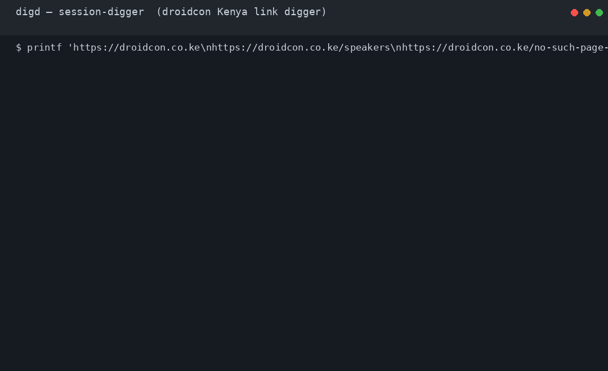

# session-digger — droidcon Kenya link digger

A **Rivium** application that digests droidcon.co.ke links: fetches a URL,
extracts the page title, and records its **SHA-256** — with crash-safe
persistence and a Material 3 Android front-end including a **Quick Settings
tile**.

## What session-digger does

droidcon Kenya publishes talks, speakers, and sponsors as web pages that
change without notice. session-digger is a pocket backend that keeps proof of
what a page actually contained when you saved it:

- **Dig any droidcon link** — paste it in the app, tap the **Digger** Quick
  Settings tile, or pipe URLs to the desktop daemon. Each job is fetched,
  its `<title>` extracted, and the SHA-256 of the raw body recorded.
- **Jobs survive the process** — every task is persisted in an
  `apalis-sqlite` durable queue before it runs; a kill mid-fetch is healed by
  the backend's heartbeat sweep on the next boot (proven by a SIGKILL e2e
  test, no hand-written replay logic).
- **Watch results live** — the Rust worker pushes every state transition
  over JNI: the Compose list updates in place, the QS tile subtitle counts
  pending jobs, and terminal states raise a notification.
- **View the list of speakers** — the droidcon **speakers directory** gets
  special treatment: digesting `droidcon.co.ke/speakers` additionally
  harvests every speaker's name and role into the ledger, shown in the
  app's **Speakers** tab (see below).

One job type (`DigestJob`), one embedded Rust host, three supervised
services: `digest-worker`, `enqueue-pump`, and (desktop) `link-ingest`.



A captioned video of the same kind of run (real `digd` session, no audio —
the captions tell the story: durable queue, title + SHA-256, the speakers
harvest, the 404 retry path, and EOF):


```
QS tile ─┐                          ┌─> notifications
Compose ─┼─> NativeBridge.nativeEnqueue (JNI)
stdin ───┘            │
                      v
             enqueue channel (tokio mpsc)
                      │
             ┌── enqueue-pump ────────────┐
             │  admit URL (dedupe) into   │
             │  the digest index          │
             └──────────┬─────────────────┘
                        v
             apalis-sqlite  SqliteStorage  <─ durable queue (queue.db)
             (WAL, migrations, orphaned-task re-enqueue after a crash)
                        │
             apalis worker
             (parallelize -> concurrency(4) -> retry x2)
                        │
             reqwest GET -> <title> + SHA-256
                        │
                        ├─ speakers page? harvest <h4>+<p> cards ─┐
                        │                                         v
             index.mark_done -> JobEvents.onJobUpdate (JNI)   speakers table
                                    JobEvents.onSpeakers  <────────────┘
```

## View the speaker list

When one wants to view the list of speakers, the app has a dedicated tab:

1. Open **Speakers** and tap **Load speaker list** — the app enqueues
   `https://droidcon.co.ke/speakers` like any other link.
2. The worker digests the page (title + SHA-256 as usual) and, because the
   URL is the speakers directory, also harvests each speaker card
   (`<h4>` name plus role paragraph) into the ledger's `speakers` table.
3. The list is pushed to the UI over a second JNI callback
   (`JobEvents.onSpeakers`) and rendered as cards. It is persisted in the
   ledger, so it reopens with the app — both tabs rehydrate from the same
   SQLite mirror at startup (`DigestStore`).

On the desktop the same run prints each harvested speaker to stdout, and the
archived list is a plain SQL query away:

```bash
cargo run --bin digd -- --root ./demo-root
# paste: https://droidcon.co.ke/speakers
sqlite3 demo-root/data/jobs.db 'SELECT name, role FROM speakers;'
```

## Layout

| Path | What |
| --- | --- |
| `rust/` | Rivium workspace: digest index, apalis-sqlite queue, digest jobs (title/SHA-256/speaker harvest), services, JNI bridge |
| `rust/src/bin/digd.rs` | Desktop daemon (`digd --root <dir>`, URLs on stdin) |
| `android/` | Gradle project: Compose UI (Digests + Speakers tabs), `DigTileService`, `RustHost`, `JobEvents`, `DigestStore` |
| `scripts/build-android-rust.sh` | `cargo-ndk` arm64-v8a build hooked into `preBuild` |
| `docs/demo.gif` | Terminal demo GIF of a real laptop run (top of this README) |
| `docs/demo.mp4` | Captioned video of a real laptop run, no audio (top of this README) |

## Desktop quick start

```bash
cd rust
cargo run --bin digd -- --root ./demo-root
# paste URLs, one per line:
#   https://droidcon.co.ke
#   https://droidcon.co.ke/speakers  ← also harvests the speaker list
#   !https://droidcon.co.ke/broken   ← re-queue a failed job
# Ctrl-D (EOF) stops gracefully
```

Results land in `demo-root/data/jobs.db` (the digest index; the durable
queue is `demo-root/data/queue.db`, both SQLite):

```sql
SELECT url, state, title, sha256, attempts, error FROM jobs;
```

## Android quick start

1. Install Rust + `cargo install cargo-ndk`, plus an NDK (`ANDROID_NDK_HOME`).
2. `cd android && ./gradlew :app:assembleDebug`
   — Gradle runs `scripts/build-android-rust.sh` via the `preBuild` hook and
   packages `libsession_digger.so` (arm64-v8a). Without a Rust toolchain the
   script degrades to a no-op so Kotlin-only builds still compile.
3. Install on a device, allow notifications, then either:
   - tap **Dig** in the app, or
   - pull down Quick Settings, add the **Digger** tile, tap it.

## Persistence guarantee

The **durable queue is `apalis-sqlite`** (`queue.db`): pushed tasks are
persisted with their own WAL journal, and a worker killed mid-task has its
orphaned task re-enqueued by the backend's heartbeat sweep within seconds of
the next boot — no hand-written replay logic. The digest index (`jobs.db`)
records results (title, SHA-256, attempts, error) plus the archived speaker
list for the UI, dedupe, and startup rehydration. Recovery is verified by
`rust/tests/laptop.rs::e2e_sigkill_replay` (SIGKILL mid-fetch, restart, same
URL completes with the same hash).

## Test & verify

```bash
cd rust
cargo test                        # unit tests (ledger, entity decoding, speaker harvest)
cargo test --test laptop -- --ignored   # live e2e vs droidcon.co.ke
cargo clippy --all-targets        # zero warnings
```

## Rivium usage map (challenge scoring)

| Requirement | Where |
| --- | --- |
| Embedded host on Android | `rust/src/android_export.rs` (`JNI_OnLoad`) + `rivium-jni` five-method contract |
| `App` trait composition | `rust/src/app.rs` (`DiggerApp`: Config/validate/services) |
| Supervised services | `rust/src/services.rs` (`digest-worker`, `enqueue-pump`, `link-ingest`) |
| Durable storage | `apalis-sqlite` `SqliteStorage` (`queue.db`) + digest index (`rust/src/ledger.rs`, statuses use `apalis-core::task::status::Status`) |
| apalis layers, in order | backend → `parallelize(tokio::spawn)` → `concurrency(n)` → `retry(RetryPolicy::retries(2))` |
| Logs under `<root>/logs/` | written by the rivium host automatically |
| Strict CLI (`--root/--config/--set`) | provided by `rivium_host::process::run` |

## Challenge must-haves (how this repo addresses them)

| Challenge requirement | Addressed by |
| --- | --- |
| Rust code uses both Rivium and Apalis | `rust/` — rivium 0.2.0 `App` + supervised services, apalis 1.0.0 worker (map above) |
| One job type | Link digest: fetch a URL, extract `<title>`, record SHA-256 (`rust/src/jobs.rs`) — the speaker list is derived from that same digest of the speakers directory |
| Runs on a laptop with `cargo run` | `cargo run --bin digd -- --root ./demo-root` — demo GIF at the top of this README |
| Runs inside the Android app | `JNI_OnLoad` via `rivium-jni` boots the embedded host in-process (`rust/src/android_export.rs`) |
| Jobs are saved across close/reopen | `apalis-sqlite` durable queue — crash recovery proven by `rust/tests/laptop.rs::e2e_sigkill_replay`; the UI rehydrates both tabs from the SQLite mirror (`DigestStore.kt`) |
| One Android feature | **Quick Settings tile** — a tap enqueues, the subtitle shows the pending count (`DigTileService.kt`); progress notifications via JNI callbacks |
| A short README | This file — what it does, how to run it, versions pinned below |
| Short video or GIF of it working | `docs/demo.gif` and `docs/demo.mp4` (captioned, no audio) — both real terminal runs, embedded above |
| Bonus (+10): real-device testing | pending — phone run results (logcat + photos) will be posted as a PR comment after the device test |

## Versions

- Rust 1.99.1 · rivium 0.2.0 · apalis 1.0.0 · apalis-sqlite 1.0.0 (sqlx 0.9) · jni 0.22.4 · rusqlite 0.32 (bundled)
- AGP 8.7.3 · Kotlin 2.0.21 · Compose BOM 2024.12.01 · compileSdk 35 · minSdk 26 · arm64-v8a
